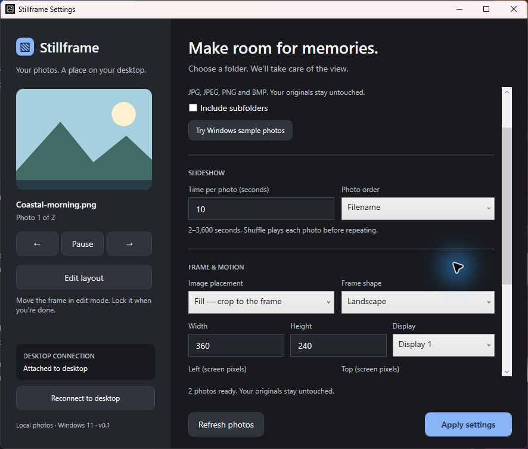
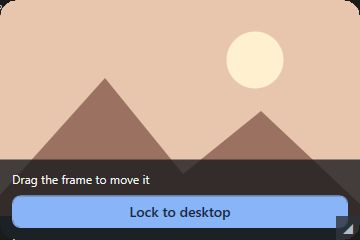

# Stillframe

A Windows 11 photo widget that displays a local folder as a slideshow, behind desktop icons and application windows. The installer includes .NET 10.

## Screenshots

Actual running app with demo images: Settings while attached to the desktop, and the photo frame in layout edit mode.





## Use

Open Stillframe, choose a folder with **Browse**, and select **Apply settings**. Use **Edit layout** to move or resize the frame, then **Lock to desktop**. Closing Settings keeps the slideshow running; use the tray icon to reopen Settings or exit.

## Main functions

- **Photo library:** scans JPG, JPEG, PNG and BMP files, optionally including subfolders; watches for folder changes.
- **Slideshow:** play/pause, next/previous, adjustable interval, filename/date order and nonrepeating shuffle.
- **Photo frame:** Fit/Fill, smooth antialiased corners, display-aware photo resolution, gentle 1.6-second fades, optional slow zoom and reduced motion.
- **Desktop layout:** saved size, position and display; edit/lock controls and desktop reconnection.
- **Preferences:** saves settings locally; optional startup at sign-in. Original photos are read only.

## Code and development

The code lives in this `Source` folder. See [architecture.md](architecture.md) for the main components. This folder is a Git repository; commits are kept small and focused on one change.

With the .NET 10 SDK installed:

```powershell
dotnet build Stillframe.slnx
dotnet test tests/Stillframe.Tests/Stillframe.Tests.csproj
dotnet run --project src/Stillframe/Stillframe.csproj
```

`scripts/Build.ps1` creates a self-contained Windows x64 package; pass `-InnoCompiler` to build the installer. `scripts/Verify.ps1` runs application checks with an isolated profile.

Settings and logs are stored in `%LOCALAPPDATA%\Stillframe`. Desktop attachment uses Explorer internals, so compatibility can vary between Windows builds. This is an unsigned development release.

## Download and releases

Download **Stillframe-Setup-0.1.4.exe** from [GitHub Releases](https://github.com/SebastianVi1/stillframe/releases). It installs the app and its runtime for Windows 11 x64; no .NET SDK or separate runtime installation is needed. A release download becomes available after its installer is uploaded and published.

See [RELEASING.md](RELEASING.md) for build, compatibility checks and publishing steps. Upload the setup installer; the standalone `Stillframe.exe` from the build folder depends on other packaged files.
